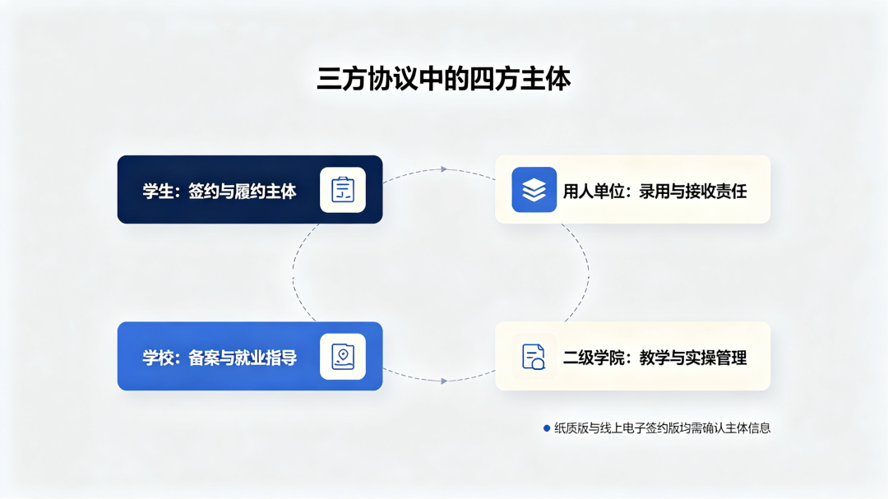
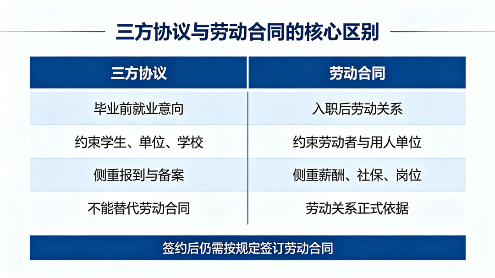
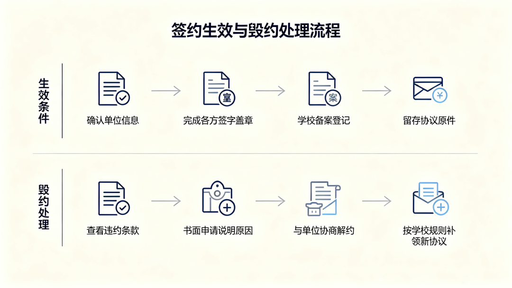

# 大学生三方就业协议多维度解读

> 作者：红湖先生
> 来源：微信公众号（红湖先生）
> 原文链接：https://mp.weixin.qq.com/s/IvsQqohAlOkH_0yzR7EKHQ
> 发布时间：2026-07-30
> 说明：本文由公众号原文导出整理；引用与数据截至原文发布时间，具体政策以最新官方文件为准。

---

> 大学生就业科普 · 三方协议专题
>
> 从定义到毁约、从纸质到网签、从生效到失效——一份覆盖九大核心板块的深度指南。
>
> 内容来源：教育部、人社部、各省市人社厅/教育厅官方公开政策；整理日期：2026 年 7 月。

### 目录导航

1. 三方协议完整定义与四方主体
2. 签约形式法律效力认定
3. 违约条款与高校保护性政策
4. 三方协议与劳动合同核心区别
5. 正式生效的必备完整条件
6. 签约后必做事项与高危注意事项
7. 三方毁约完整处理体系
8. 完整时效性规则
9. 往届未就业毕业生签约规则

## 01三方协议完整定义与四方主体说明

### 官方定义与政策依据

三方协议全称**《全国普通高等学校毕业生就业协议书》**，是毕业生、用人单位和高等学校三方共同签订的书面协议，用于明确三方在毕业生就业择业过程中的权利义务关系。其核心政策依据是原国家教育委员会1997年发布的**《普通高等学校毕业生就业工作暂行规定》**（教学〔1997〕6号），该文件第二十四条明确要求："经供需见面和双向选择后，毕业生、用人单位和高等学校应当签订毕业生就业协议书，作为制定就业计划和派遣的依据。"[1]

三方协议的法律性质属于**民事协议**，而非劳动合同。它在毕业生到用人单位报到、正式建立劳动关系后自行终止，随后由劳动合同取代。协议的主要功能是明确就业意向、约束签约三方在签约至报到期间的行为，并作为学校办理档案转递、户口迁移等就业手续的依据[2]。

### 三方签约主体权责

根据教学〔1997〕6号，三方协议的法定签约主体为三方：毕业生、用人单位、高等学校。该文件同时明确："未经学校同意，毕业生擅自签定的协议无效。"[1]各主体的核心权责如下：

| 主体 | 核心权利 | 核心义务 |
| --- | --- | --- |
| **毕业生** | 在国家就业方针政策指导下自主择业 | 如实介绍自身情况；履行协议约定；违反协议承担赔偿责任 |
| **用人单位** | 参加供需见面、双向选择 | 如实介绍单位情况；按计划接收毕业生且不得拒绝接收或退回；负责见习期管理；违约承担赔偿责任 |
| **高等学校** | 对协议享有审核同意权（学校不同意则协议无效） | 资格审查与推荐；收集发布需求信息；办理离校手续；违约承担赔偿责任 |

来源：教学〔1997〕6号 第二条、第九条、第十条、第二十四条、第四十八条[1]

### 二级学院：第四方实操参与主体

官方文件中，三方协议的签约主体严格为三方，二级学院（院系）并非独立签约方。但在实际操作中，二级学院作为高校内部的行政执行层级，承担着不可替代的实操职能。教育部2024年发布的《关于做好2025届全国普通高校毕业生就业创业工作的通知》（教就业〔2024〕5号）第十九条明确提出，要充分发挥**"校—院（系）"两级就业工作领导小组**作用[4]。

二级学院在三方协议流转中的实操权责包括：

- **审核鉴证**

  在教育部网上签约平台流程中，用人单位发起签约邀约、毕业生确认后，需经院校（含院系）审核通过方能完成签约。院系承担第一道审核职责
- **信息核验**

  核验毕业生专业名称是否与毕业证一致、用人单位信息是否准确
- **就业推荐**

  支持院系开展小型专场招聘活动，提高校园招聘实效[4]
- **违约审批**

  毕业生申请毁约时，需经院系辅导员签字确认
- **盖章效力**

  部分高校要求协议书加盖院系章作为校内审核环节，但院系章的法律效力低于学校公章，不具备独立使协议生效的效力

关键区分

二级学院是三方协议流转中的**实操参与主体**，而非独立签约主体。协议的法律效力来源于三方签字盖章（毕业生签字、单位公章、学校公章），院系章仅作为校内审核程序的一部分。

## 02签约形式法律效力认定

### 纸质与电子签约同等效力

2022年7月6日，教育部办公厅发布《关于推荐使用全国高校毕业生网上签约平台的公告》，明确认定：**"电子就业协议书效力相同。网上签约电子就业协议书与纸质三方协议书效力相同。"**[2]这一公告由教育部通过"中国教育发布"官方渠道发布，人民网同日转载确认[3]。

该公告同时指出，开通网上签约平台是"为落实《国务院办公厅关于进一步做好高校毕业生等青年就业创业工作的通知》（国办发〔2022〕13号）精神"[6]。这意味着纸质三方协议与电子三方协议在法律效力上完全等同，用人单位不得以"只认可纸质协议"为由拒绝接受电子签约。

### 两种签约形式的对比

| 维度 | 纸质三方协议 | 网上签约电子三方协议 |
| --- | --- | --- |
| 法律效力 | 与电子协议完全等同[2] | 与纸质协议完全等同[2] |
| 单位公章 | 必须加盖单位公章（原章） | 用人单位已在平台注册审核的，可不用盖企业公章 |
| 签约流程 | 线下填写、盖章后由毕业生上传系统登记 | 单位发起邀约→学生确认→院校审核→生成唯一协议编号 |
| 存档方式 | 一式三份，单位、学生、学校各执一份原件 | 签约成功后可下载电子版存档，或扫描协议二维码查看 |
| 信息核验 | 手动填写，存在信息不一致风险 | 生源信息来自学信网，已进行学籍认定与实名认证 |

来源：教育部办公厅公告[2]；国家大学生就业服务平台[10]

### 国家大学生就业服务平台

教育部开通的全国高校毕业生网上签约平台（网址：dj.ncss.cn）由教育部全国高等学校学生信息咨询与就业指导中心运营，提供四大核心功能：线上签约/解约、线下签约/解约登记、已签纸质协议补充登记、其他毕业去向信息登记[9]。

2025年4月，中共中央办公厅、国务院办公厅联合印发《关于加快构建普通高等学校毕业生高质量就业服务体系的意见》，第十八条明确要求"建强国家大学生就业服务平台"，"制定高校毕业生数字化就业服务标准规范"，进一步从国家政策层面确认了数字化就业签约的合规地位[5]。

注意事项

无论采用纸质还是电子签约，协议均需经学校审核同意后方为有效。学生不得绕过学校自行与用人单位签订协议——根据教学〔1997〕6号，"未经学校同意，毕业生擅自签定的协议无效。"[1]

## 03违约条款与高校专属保护性政策

### 违约金的通用规则

三方协议在司法实践中被主流认定为**一般民事合同/预约合同**，适用《民法典》合同编而非《劳动合同法》。因此，《劳动合同法》第二十五条关于"违约金仅限服务期和竞业限制"的严格限制**不适用于三方协议**。违约金条款只要是各方真实意思表示，即合法有效[11]。

《民法典》第五百八十五条规定，当事人可以约定违约金数额；约定的违约金过分高于造成损失的，当事人可以请求人民法院或仲裁机构予以适当减少。司法实践中通常以"超过实际损失30%"作为判断"过分高于"的参考标准。法律并未对三方协议违约金设定具体的法定上限或下限[20]。

### "5000元"的行业惯例性质

教育部主管的国家大学生就业服务平台在就业指导中建议："通常公司在签约时会提出违约金的金额，毕业生要在协商中力争将违约金降到最低，**通常不超过5000元**。违约金特别高的单位要慎签。"[10]中央财经大学法学院在普法微课堂中同样表述为"建议违约金不超过5000元"[20]。

据《劳动观察》2025年1月报道，在教育部2019年提出的一条建议推动下，企业、高校与毕业生签订的三方协议中普遍把违约金限定在5000元[19]。但需明确：**"5000元"是行业惯例建议，并非具有强制力的行政规范性文件**。过高违约金可依据《民法典》第五百八十五条请求法院调低。

关键澄清

网络上流传的"教育部《2026年高校毕业生就业权益保护指引》"（含"7天冷静期""违约金不超过1个月工资"等说法）在教育部官网及中国政府网均未检索到原文，不同来源对其条款编号和内容说法相互矛盾，**极可能为虚构内容，请勿采信**。

### 高校保护性豁免政策

部分省份通过省级政府文件或省级教育厅统一印制的协议书格式条款，为毕业生设立了保护性豁免规则。毕业生在毕业离校前升学、入伍或被录用为公务员时，可不视为违约、不承担违约金。

#### 江苏省

江苏省人民政府办公厅苏政办发[2003]53号文件第四条规定："已与用人单位签订就业协议（合同）的应届高校毕业生，在毕业离校前**升学、入伍或被录用为国家公务员（含参照部门），不视为违约，用人单位不得收取违约金**。"[16]

江苏省教育厅统一印制的就业协议书第十一条进一步列明五种自动解除情形，包括升学、入伍、被录用为公务员、参加国家及地方志愿服务项目等[16]。

#### 安徽省

《安徽省普通高等学校毕业生网签就业协议书》第七条规定：当乙方因考取公务员（事业单位）、升学（留学）、参加国家及地方政府项目（选调生、大学生志愿服务西部计划、"三支一扶"、特岗教师、入伍等）而无法履行协议的，"如没有约定，**乙方可单方解除协议，不承担违约责任**。"[16]

#### 国家大学生就业服务平台（教育部主管）

教育部主管的国家大学生就业服务平台明确指引："签三方后不想去怎么办？提供如下材料，**学校不做违约处理**：签约单位出具同意解除就业协议的书面证明；**继续攻读学位或考取公务员，可凭录取通知书或复印件办理**；本人申请报告，并附学校意见。"[10]

#### 应征入伍

教育部高校学生司、国防部征兵办公室《国家鼓励普通高等学校应届毕业生应征入伍服义务兵役政策五十问》明确：普通高校毕业生应征入伍需要变更就业协议，**不属于违约**。依法参军服兵役是公民义务，受国家法律和政策保护。

豁免政策适用要点

**1. 适用时间**：多数省份豁免政策要求在"毕业离校前"触发，即取得录取通知书等证明材料须在毕业离校前提交

**2. 证明材料**：需提供录取通知书（或复印件）作为豁免依据

**3. 省域差异**：上述豁免政策主要体现在部分省份的省级文件和协议书格式条款中，并非全国统一的法律强制条款。毕业生须查询本省教育厅或毕业高校就业指导中心的具体规定

**4. 报备流程**：向学校就业指导中心提交录取通知书复印件+本人书面申请→院系辅导员签字→学校审核确认→不做违约处理

### 违约对征信与就业的影响

三方协议违约属于民事违约，依据《征信业管理条例》第十四条，**不会直接记入央行征信系统**。仅当违约行为经法院判决后仍拒不执行、被列为"失信被执行人"时，才会间接影响个人征信。

但违约仍可能产生以下影响：部分高校将违约情况记录在案，影响后续就业推荐与评优；部分大型企业或国企将违约行为记入内部人才库，影响未来应聘；若用人单位为机关事业单位，解约可能被记入当地招聘"诚信档案"，影响后续同类单位报考。三方协议违约**不影响应届生身份认定**——只要未签订劳动合同、未缴纳社保，仍保留应届生身份[18]。

## 04三方协议与劳动合同核心区别

北京市房山区人民法院在相关案件审理中明确指出："三方协议属于普通民事合同，引发的纠纷应当适用《民法典》总则编和合同编的规定，不能适用劳动法律法规"；"毕业生到用人单位报到后，三方协议即自动失效，故三方协议的法律效力终止于毕业生报到之时，三方协议不能代替劳动合同。"[11]

### 五维度对比

| 维度 | 三方协议 | 劳动合同 |
| --- | --- | --- |
| **法律效力** | 民事合同，受《民法典》合同编调整，不建立劳动关系 | 受《劳动法》《劳动合同法》调整，是确立劳动关系的法定凭证 |
| **适用阶段** | 在校期间至到单位报到、正式建立劳动关系前 | 自用工之日起建立劳动关系时签订（用人单位须自用工之日起一个月内订立书面合同） |
| **约束主体** | 三方：毕业生、用人单位、学校 | 双方：劳动者、用人单位 |
| **作用目的** | 明确就业意向，作为学校办理档案、户口等手续的依据 | 明确工作岗位、劳动报酬、工作时间、社保、试用期等劳动权利义务 |
| **失效条件** | 毕业生报到、正式建立劳动关系后自动终止 | 按合同约定期限届满或法定解除条件成就时终止 |

来源：司法实务口径[11]；《劳动合同法》第十条

### 为什么三方协议无法被劳动合同替代

三方协议解决的是"毕业前到入职前"这一时间窗口内的就业意向约束问题。在这一阶段，毕业生尚未毕业、尚不具备建立劳动关系的主体资格，劳动合同无法提前签订。三方协议承担了三项劳动合同无法覆盖的功能：约束毕业生按时报到、约束用人单位按时接收、为学校办理派遣和档案转递提供依据。

如果毕业生只签劳动合同不签三方协议，将面临以下问题：学校无法在毕业去向登记系统中登记就业信息，影响就业统计与离校手续；档案去向不明确，可能滞留在学校或被退回户籍地；部分城市落户政策仍以三方协议或毕业去向登记信息作为应届生就业凭证[14]。

认知误区纠正

误区一："签了三方就等于签了劳动合同。"——错误。三方协议是就业意向约定，不建立劳动关系，入职后仍须签订劳动合同。

误区二："三方协议可以代替劳动合同。"——错误。用人单位不得以已签三方协议为由拒绝签订劳动合同，否则需依法支付未签书面劳动合同的双倍工资差额[11]。

误区三："没签三方只签劳动合同也行。"——技术上可以，但会影响学校毕业去向登记和档案转递，建议应届生按正规流程签订三方协议。

## 05正式生效的必备完整条件

三方协议由教育部高校学生司统一制表，具体签订规范由各高校自行制定实施细则。以下为各高校通行的生效条件，缺一不可：

### 条件一：三方签字主体齐全

毕业生本人亲笔签名（或电子签名）；用人单位法定代表人或授权代表人签字（或加盖单位公章）；学校（培养单位）签字盖章。教学〔1997〕6号明确规定，未经学校同意，毕业生擅自签定的协议无效[1]。

### 条件二：盖章规范完整

- **学校公章**

  学校就业主管部门（就业指导中心）统一办理，部分高校由教务处或学生处集中用印
- **院系章**

  部分高校要求二级学院审核盖章作为校内流程环节
- **单位公章**

  用人单位须加盖单位公章（原章）；使用网上签约平台且单位已注册审核的，可不用盖企业公章[9]
- **协议份数**

  一式三份，用人单位、毕业生、学校各执一份，复印无效

### 条件三：信息填写规范一致

专业名称须与毕业证名称完全一致；用人单位名称须与协议落款、印章名称一致；违约金条款应明确数额；薪资、岗位等约定事项须清晰无歧义。

### 条件四：备案登记流程完成

2023年取消报到证后，根据人社厅发〔2023〕20号文件，已取消高校毕业生离校前公共就业人才服务机构在就业协议书上签章环节[7]。取而代之的是**毕业去向登记制度**：毕业生须在离校前通过全国高校毕业生毕业去向登记系统（dj.ncss.cn）登记个人毕业去向信息，在离校时统一确认[8]。

生效条件自查清单

以上四个条件须**同时满足**方为合法有效签约。任何一项缺失可能导致协议未有效签署：缺毕业生签字→协议不成立；缺学校盖章→协议无效；单位名称与公章不一致→存在效力瑕疵；未完成毕业去向登记→影响离校手续与档案转递。

高危提醒

协议书中留有空白条款未填写的，建议在签字前明确填写或划掉空白处。空白协议签字后可能被事后填写不利于毕业生的条款。

## 06签约后必做事项与高危注意事项

### 档案去向

依据人社厅发〔2023〕20号文件，档案转递去向根据就业类型确定[7]：

| 就业去向 | 档案转递去向 |
| --- | --- |
| 机关、国有企事业单位或定向就业 | 转递至就业单位或定向单位 |
| 非公单位就业、灵活就业、自主创业 | 转递至就业创业地或户籍地公共就业人才服务机构 |
| 暂未就业 | 可根据本人意愿转递至户籍地公共就业人才服务机构，或按规定在高校保留两年 |

严禁事项

学生档案**不能由高校毕业生个人自带和保管**。高校按规定通过机要通信或邮政特快专递渠道转出档案，并填写《高等学校毕业生档案转递单》[7]。

### 报到证制度已取消（2023年起）

2023年起，国家**不再发放**《全国普通高等学校本专科毕业生就业报到证》和《全国毕业研究生就业报到证》。取消报到证补办、改派手续，不再将报到证作为办理招聘录用、落户、档案接收转递等手续的必需材料[6][15]。

用人单位入职报到的新规为：可凭劳动（聘用）合同或就业协议书（含网签协议）或普通高等教育学历证书或其他双方约定的证明材料，为高校毕业生办理报到入职手续，参加工作时间按照高校毕业生毕业后实际入职之日计算[6]。

### 毕业去向登记（2023年新制度）

依据教学厅〔2023〕5号文件，毕业去向登记是毕业生办理离校手续的**必要环节**[8]。毕业生须在离校前通过全国高校毕业生毕业去向登记系统（dj.ncss.cn）或省级系统登记个人毕业去向信息，在离校时统一确认。去向信息登记后有变更的，需在**当年8月31日前**及时更新[8]。

### 留存备份

- 三方协议一式三份，毕业生应妥善留存自己的一份原件
- 电子签约的，可通过平台下载电子版存档
- 劳动合同原件应与三方协议分开保管
- 可通过中国高等教育学生信息网（chsi.com.cn）查询验证学历学位信息
- 户籍和档案接收管理部门经毕业生本人授权后，通过全国登记系统查询核验去向登记信息[14]

### 高危注意事项

五大高危风险

**1. 空白协议风险**：签字前未填写完整条款，事后可能被填写不利内容

**2. 档案滞留风险**：未及时登记毕业去向，档案可能滞留学校超过两年后被退回

**3. 个人自带档案风险**：任何情况下不得自行携带档案，个人自带档案将被接收单位拒收

**4. 信息不一致风险**：专业名称、单位名称与公章不一致，可能导致协议效力瑕疵

**5. 超期变更风险**：去向信息变更未在当年8月31日前更新，影响后续手续办理[8]

## 07三方毁约完整处理体系

### 合法毁约的触发场景

以下场景可依法/依规申请毁约：原单位出具书面同意解除协议的证明（协商解约）；毕业生升学、入伍、考取公务员或参加国家及地方志愿服务项目（保护性豁免，详见第三板块）；用人单位存在欺诈、虚假宣传等违法行为；协议约定的解除条件成就。

### 毁约处理流程

教育部主管的国家大学生就业服务平台明确规定了毁约流程[10]：

#### 常规毁约流程（派遣前/取消报到证后）

1. **取得原单位书面解约函**

   原用人单位出具同意解除就业协议的书面证明（退函）
2. **本人提交书面申请**

   写明毁约理由，经院系辅导员签字确认
3. **准备新单位签约材料**

   新单位的录用证明或签约意向
4. **交还原协议书**

   将原协议书上交学校招生就业工作处
5. **换取新协议书**

   学校审核通过后发放新的就业协议书（编号固定，每位毕业生只有一套）

#### 豁免情形的简化流程

继续攻读学位或考取公务员的，可凭录取通知书或复印件直接办理，学校不做违约处理[10]。签约单位出具同意解除书面证明的，也可直接办理。

### 网上签约平台的解约流程

1. 用人单位或毕业生在全国高校毕业生网上签约平台发起解约申请
2. 对方确认同意解约
3. 院校审核通过后解约生效
4. 毕业生可在线申请新的就业协议书

### 新三方申领规则

- 每位毕业生只有一套就业协议书（一式三份、编号固定）
- 必须先办理完毕与原单位的解约手续（取得书面退函/解约函），交还原协议书，方可换取新协议书
- 违约手续建议在5月底前办理（因6月初需向教育部上报毕业生就业计划）[16]

### 常见纠纷规避

| 常见纠纷 | 规避方案 |
| --- | --- |
| 单位拒绝出具解约函 | 书面催告；若属保护性豁免情形（升学/考公），可凭录取通知书直接向学校申请 |
| 单位要求高额违约金 | 依据《民法典》第585条请求法院/仲裁机构调低；若属保护性豁免情形，单位不得收取违约金 |
| 学校不予办理新协议 | 确认毁约理由是否正当、材料是否齐全；5月底后办理需上报教育部审批 |
| 网签解约后无法重新签约 | 确认院校是否已审核通过解约；检查平台状态是否已释放签约名额 |

## 08完整时效性规则

### 生效起始时间

三方协议自**三方签署完成之日**起生效，即毕业生签字、用人单位盖章（或电子签约确认）、学校盖章（或审核通过）全部完成之日。任何一方未完成签署，协议不生效。

### 正常有效周期

三方协议的有效期自签约日起至毕业生到用人单位报到之日止。在此期间，协议对三方均有约束力：毕业生应按时报到，用人单位应按时接收，学校应据此办理派遣手续[17]。

### 自动失效节点

毕业生到用人单位报到、正式建立劳动关系后，三方协议效力自动终止。北京市房山区人民法院在相关案件审理中认定："三方协议的作用仅限于对学生就业过程的约定，毕业生到用人单位报到后，三方协议即自动失效。"[11]

签订劳动合同后三方协议失效的法律依据：三方协议属于民事合同，其使命在于约束"正式建立劳动关系前"的行为。当劳动关系正式建立（签订劳动合同）后，三方协议约定的权利义务被劳动合同所取代，故失效。依据《劳动合同法》第十条，建立劳动关系应当订立书面劳动合同[11]。

特殊情形

若三方协议中有特别约定（如服务期、违约金等补充条款），即便签订劳动合同后，这些特别约定的条款仍可能继续有效，除非被劳动合同明确替代。毕业生在签约时应仔细阅读是否有此类条款。

时效性总结

**生效日**：三方签字盖章/审核全部完成之日

**有效期**：自签约日起至报到日止

**失效日**：毕业生报到、建立劳动关系（签订劳动合同）之日

**失效依据**：《民法典》合同编法理+《劳动合同法》第十条+司法裁判口径[11]

**备注**：上述时效规则为高校就业工作通行口径和司法裁判口径，目前未见教育部或人社部以专门规范性文件形式作出明确表述

## 09往届未就业毕业生次年签约规则

### 择业期与应届生身份认定

根据国家公务员局《中央机关及其直属机构考试录用公务员报考指南》的口径：国家统一招生的普通高校毕业生，离校时和在择业期内（**国家规定为二年**）未落实工作单位，其户口、档案、组织关系仍保留在原毕业学校，或保留在各级毕业生就业主管部门、人才交流服务机构、公共就业服务机构的，**可按应届高校毕业生对待**[18]。

真正影响应届生身份认定的核心标准是：是否签订正式劳动合同、是否缴纳城镇职工社会保险、是否落实工作单位。只签三方协议但未入职、未缴职工社保的，仍属应届生[18]。

### 往届生是否需要重签三方协议

权威说明

关于"往届生、暂缓就业人员第二年是否需要重签三方协议"，经检索，**未找到教育部、人社部或国务院层面发布的专门规范性文件**对此作出明确规定。以下信息基于法律解读和高校就业指导通识，仅供参考，具体须以毕业高校就业指导中心或当地省级人社部门的答复为准。

从法律层面看，三方协议的本质是应届毕业生、用人单位、学校之间的就业意向性协议，核心目的是配合学校完成就业统计与档案转移。往届生已完成毕业流程，与用人单位建立劳动关系时，法律要求签订的是**劳动合同**而非三方协议。依据《劳动合同法》第十条，建立劳动关系应当订立书面劳动合同[21]。

部分高校允许毕业生在毕业1至2年内申请"暂缓就业"，档案仍保留在学校。若往届生处于暂缓就业期，且用人单位要求通过学校办理就业手续，可能需与学校、用人单位补签三方协议，但此类情况较少见[21]。

### 与应届生的核心区别

| 维度 | 应届生 | 往届生（择业期内） |
| --- | --- | --- |
| 签约方式 | 签订三方协议+劳动合同 | 一般直接签订劳动合同 |
| 应届身份 | 天然具备 | 择业期（二年）内未落实工作单位可按应届生对待[18] |
| 三方协议 | 可正常申领签订 | 一般无需签订；个别高校暂缓就业期内可补签 |
| 档案管理 | 学校统一转递 | 已转至户籍地或人才机构，由个人或单位办理转递 |
| 报到证 | 2023年起已取消 | 同左，2023年起不再发放 |
| 毕业去向登记 | 毕业当年在dj.ncss.cn登记 | 已登记完成，一般无需重复 |

实操建议

往届生入职时直接签订劳动合同即可。若用人单位强制要求三方协议，建议联系毕业高校就业指导中心咨询是否可补办。各省各校政策存在差异，**以所在院校及当地人社部门最新通知为准**。

## 附2023年取消报到证后的政策衔接变化

2023年起，国家实施了毕业生就业领域的重大制度改革，核心变化如下：

| 变化项 | 2023年前 | 2023年起 |
| --- | --- | --- |
| 就业凭证 | 以就业报到证为核心 | 建立毕业去向登记制度，以系统登记信息为依据[8] |
| 协议签章 | 需到公共就业人才服务机构签章 | 取消签章环节[7] |
| 报到手续 | 需到公共就业人才服务机构办理报到 | 取消报到手续[6] |
| 档案转递 | 以报到证为必需材料 | 依据毕业去向登记信息转递，填写档案转递单[7] |
| 单位入职 | 凭报到证办理 | 凭劳动合同/就业协议/学历证书办理[6] |
| 签约方式 | 纸质为主 | 推荐网上签约，电子与纸质效力等同[2] |

政策依据链条：国办发〔2022〕13号（国务院办公厅）首次提出取消报到证[6]→ 人社部发〔2023〕26号（五部门）落实衔接措施 → 教学厅〔2023〕5号（教育部办公厅）建立去向登记制度[8]→ 人社厅发〔2023〕20号（人社部+教育部）规范档案转递[7]。

### 合规声明

本文内容整理自教育部、各省市人社厅、高校就业指导官方公开政策，仅作应届生就业科普参考，不构成签约、解约、法律决策依据，具体事宜以所在院校及官方部门最新通知为准。

本文持续更新，建议收藏转发，供身边同学参考。  
如需了解本省具体政策，请查询当地人社厅/教育厅官网或咨询毕业高校就业指导中心。

## 权威信息来源

1.国家教育委员会，《普通高等学校毕业生就业工作暂行规定》（教学〔1997〕6号），1997年3月24日发布，现行有效。http://www.moe.gov.cn/srcsite/A02/s5911/moe\_621/199703/t19970324\_81877.html

2.教育部办公厅，《关于推荐使用全国高校毕业生网上签约平台的公告》，2022年7月6日。明确"电子就业协议书与纸质三方协议书效力相同"。https://dxs.moe.gov.cn/zx/a/jj/220707/1770341.shtml

3.人民网，《高校毕业生网上签约平台开通电子协议与纸质三方效力相同》，2022年7月6日。http://finance.people.com.cn/n1/2022/0706/c444648-32467914.html

4.教育部，《关于做好2025届全国普通高校毕业生就业创业工作的通知》（教就业〔2024〕5号），2024年11月11日。http://www.moe.gov.cn/srcsite/A15/s3265/202411/t20241112\_1162526.html

5.中共中央办公厅、国务院办公厅，《关于加快构建普通高等学校毕业生高质量就业服务体系的意见》，2025年4月9日。https://www.ncss.cn/ncss/zc/qg/202504/20250409/2293372073.html

6.国务院办公厅，《关于进一步做好高校毕业生等青年就业创业工作的通知》（国办发〔2022〕13号），2022年5月13日。首提取消就业报到证。https://www.gov.cn/zhengce/zhengceku/2022-05/13/content\_5690111.htm

7.人力资源社会保障部办公厅、教育部办公厅，《关于积极稳妥做好高校毕业生档案转递接收工作的通知》（人社厅发〔2023〕20号），2023年6月。https://www.mohrss.gov.cn/wap/zc/zcwj/202306/t20230616\_501616.html

8.教育部办公厅，《关于建立高校毕业生毕业去向登记制度的通知》（教学厅〔2023〕5号），2023年。建立全国统一的毕业去向登记制度。http://big5.www.gov.cn/gate/big5/www.gov.cn/zhengce/zhengceku/202306/content\_6888023.htm

9.教育部全国高等学校学生信息咨询与就业指导中心，全国高校毕业生毕业去向登记系统（官方平台），dj.ncss.cn。https://dj.ncss.cn

10.国家大学生就业服务平台（教育部主管），《离校前的要紧事，你都知道吗？》，含毁约流程、违约金建议、考公升学豁免指引。https://vy.ncss.cn/ncss/zt/lxqdyjs.shtml

11.《民主与法制时报》法官解读"三方协议"法律风险，广东财经大学法学院转载。北京市房山区人民法院司法裁判口径：三方协议属民事合同，报到后自动失效。https://fzc.gdufe.edu.cn/2024/0604/c4511a193223/pagem.htm

12.人力资源社会保障部、教育部、财政部，《关于做好2025年高校毕业生等青年就业工作的通知》（人社部发〔2025〕20号），2025年4月。https://www.gov.cn/zhengce/zhengceku/202504/content\_7021064.htm

13.人力资源社会保障部、财政部，《关于做好2026年高校毕业生等青年就业工作的通知》（人社部发〔2026〕19号），2026年2月。https://www.gov.cn/zhengce/zhengceku/202603/content\_7063305.htm

14.教育部官网（国家大学生就业服务平台），《就业手续及时办》，2026年4月。含档案转递、去向登记核验指引。https://www.ncss.cn/ncss/gjjdfjyzc/gj/202604/20260421/2293302899.html

15.天津市教委转发中国教育报，《五部门发文取消毕业生就业报到证》，2023年5月。https://jy.tj.gov.cn/JYXW/GNJY/202305/t20230515\_6239759.html

16.安徽工业大学就业指导网，《关于就业工作的若干问题》，含安徽省网签就业协议书第七条、江苏省苏政办发[2003]53号豁免政策引用。https://dhxy.aust.edu.cn/info/1264/8959.htm

17.百色职业学院招生就业处，《一文给你讲透三方协议》，含三方协议时效性通行口径。https://www.gxbszy.cn/index.php?c=show&id=6094

18.辽宁师范大学就业指导网，《一文教你分清实习协议、三方协议、劳动合同》，含择业期应届生身份认定口径。https://lsdjyw.lnnu.edu.cn/news/view/aid/298533/tag/qzjq

19.《劳动观察》（上海），《签了三方协议却遭企业任性违约委员发声：单位赔偿5000元不该成上限》，2025年1月14日。含"5000元"行业惯例来源分析。http://www.labour-daily.cn/shsldb/zc/content/019463ab4757c0010000d7c90f012edc.html

20.中央财经大学法学院"法治之光"辅导员工作室，普法微课堂第30讲，含违约金建议标准与法律性质分析。https://ins.cufe.edu.cn/info/1075/7747.htm

21.找法网法律咨询，《往届生还要签三方协议吗》，含往届生签约规则法律解读（注：此为法律咨询平台，非官方权威来源）。https://www.findlaw.cn/wenda/q\_60390649.html
