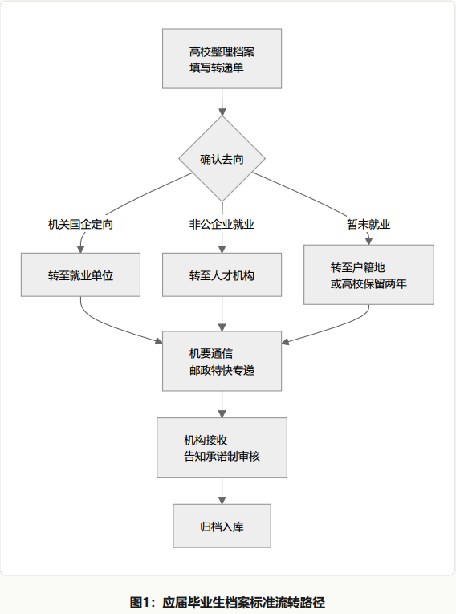
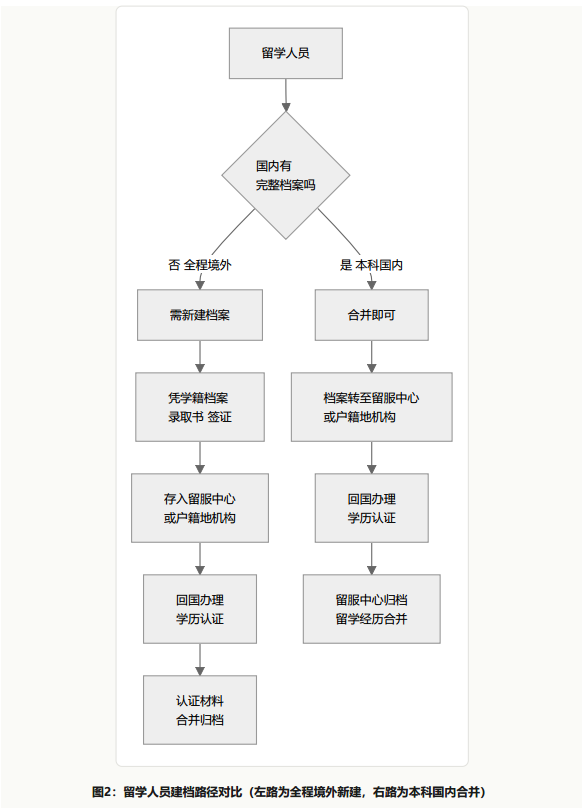

# 一次性说清楚毕业生人事档案流转

> 作者：红湖先生
> 来源：微信公众号（红湖先生）
> 原文链接：https://mp.weixin.qq.com/s/peHTUBON5XhOdZ0CemxgzQ
> 发布时间：2026-08-02
> 说明：本文由公众号原文导出整理；引用与数据截至原文发布时间，具体政策以最新官方文件为准。

---

> 政策实务 · 流动人员人事档案
>
> 以人社部官方口径为基准，融合一线人事实操经验，覆盖档案去向、转递流程、材料补录、兜底处置与高频答疑。
>
> 依据：人社部发〔2021〕112号、人社部发〔2014〕90号、教育部留服中心档案管理规定等。

## 一、先统一口径：什么是"流动人员人事档案"

本文全程采用人力资源和社会保障部官方标准表述——**流动人员人事档案**，不再使用"体制内/体制外"等非规范说法。

根据《流动人员人事档案管理服务规定》（人社部发〔2021〕112号）第四条，流动人员人事档案涵盖七类人群，其中与毕业生直接相关的包括：未就业的高校毕业生及中专毕业生的人事档案；自费出国（境）留学的高校毕业生及其他因私出国（境）人员的人事档案；非公有制经济组织和社会组织聘用人员的人事档案；自由职业或灵活就业人员的人事档案。[1]

换言之，只要你是应届或往届毕业生，就业于民营企业、外资企业、民办院校、民办非企业单位、中小型机构，或处于灵活就业、自主创业、考研考公备考、暂无正式编制岗位的状态，你的人事档案就属于"流动人员人事档案"范畴，适用本规定。

需要界定的边界是：机关、事业单位、国有企业等具备独立档案管理资质、纳入在编人事管理的岗位，其档案管理自成体系，遵循《干部人事档案工作条例》等规定，不在本文展开范围之内。仅在涉及档案调转衔接时简要提及。

核心官方规则

流动人员人事档案工作遵循"集中统一、归口管理"原则，主管部门为政府人力资源和社会保障部门。档案管理服务机构包括**县级以上（含县级）人民政府设立的公共就业和人才服务机构**，以及经省级人力资源社会保障行政部门授权的单位。其他任何未经授权的单位不得开展流动人员人事档案管理服务工作，**严禁个人保管本人或他人人事档案**。[1]

这意味着：普通用人单位没有自行保管流动人员人事档案的资质，也不能私自流转档案，只能通过公共就业和人才服务机构（以下简称"档案管理服务机构"）委托代管。自2015年1月1日起，档案保管已全面取消收费。[2]

## 二、档案去哪：不同就业去向的存放规则

档案去向取决于就业状态和单位性质，以下按实务场景分类说明。

### （一）有就业单位（民营/外资/民办单位）

这类单位不具备独立档案管理权，统一采用"企业委托档案管理服务机构代管"模式。大型规范企业和民办院校会在属地档案管理服务机构开立**单位集体存档户**，员工档案归集至该单位名下托管。小微企业无强制档案归集要求，员工档案可自愿存放在工作地或户籍地的合规档案管理服务机构。

依据112号文第七条，跨地区就业创业的流动人员，其人事档案**可由户籍所在地或现工作单位所在地的档案管理服务机构管理**。[1]

### （二）无固定就业（灵活就业/备考/个体户）

档案默认回流户籍地县区级档案管理服务机构存档，属于标准的流动人员存档方式。 依据112号文第十二条，流动人员可持本人居民身份证或社保卡等有效身份证件，到档案管理服务机构申请设立**个人账户**。[1]

### （三）出国（境）留学人员

自费出国（境）留学的高校毕业生及其他因私出国（境）人员的人事档案，明确纳入流动人员人事档案范围。[1]存放选择包括：教育部留学服务中心（以下简称"留服中心"）留学人员档案管理处、户籍地档案管理服务机构、部分高校可按规定留校保管。具体流程见下文第三部分第（三）节。

### （四）合法流转底线

实务铁规

流动人员人事档案仅可在经授权的档案管理服务机构之间，以及机关、国有企事业单位与档案管理服务机构之间进行对公流转。**个人长期自持、私自拆封、无手续调转，均不被官方认可**。毕业年限不影响调转的合规性，审核标准只看流转手续是否完整。[1]

## 三、怎么转：分人群流转流程

### （一）应届毕业生档案流转

应届生档案流转是问题最多、最易出错的环节，以下分"标准流程"与"实务异常场景"两层说明。

#### 1. 标准流转流程

依据人社部联合教育部印发的《关于积极稳妥做好高校毕业生档案转递接收工作的通知》，高校在学生毕业离校前，应按规定整理高校毕业生登记表、成绩单、党团组织关系、奖惩记录等材料，形成完整的高校毕业生档案，并根据毕业生填写的毕业去向登记信息确定就业单位名称、转递编号等内容，填写《高等学校毕业生档案转递单》后，将档案和转递单一并通过**机要通信或邮政特快专递**渠道寄出。[3][4]

依据112号文第二十条，档案转递的标准程序为：拟接收的档案管理服务机构向原档案管理服务机构或原工作单位开具**转档手续材料**（即俗称的"商调函"或"调档函"）；原机构收到后，应按规定审核档案，对符合转递规定的，填写材料目录清单后严密包封，并填写档案转递通知单，于**15个工作日内**进行转递。接收时实行告知承诺制，接收机构应及时将转递通知单回执退回原机构。[1]

需要强调的是，档案管理服务机构开具的转档手续材料，与机关、国有企事业单位开具的人事档案转档手续材料**具有相同的效力**，流动人员人事档案在这三类机构之间可直接办理转档手续。[1]

2. 实务三大共性异常场景与解法

以下场景为一线人事实操经验，通用科普资料较少涉及。

**场景一：学校批量统一打回原籍。**部分高校不逐一核对毕业生就业信息，将全部档案统一退回学籍户籍地档案管理服务机构，导致异地就业学生所在单位查无档案。

实操解法：档案落地户籍地档案管理服务机构后，由就职单位人事向该机构开具转档手续材料（商调函），本人携带身份证及商调函前往办理异地转出调转。

**场景二：人社部门业务拆分导致档案错分。**部分地市的人力资源和社会保障局内设的学生档案管理部门（负责接收应届生档案、逐层下发）与公共人才档案流转部门（负责日常托管调转）存在业务分工，虽然合署办公但系统独立。学校统一邮寄的批量档案容易归入中转库，无法被企业端及时查询识别，本地市就业场景高发。

实操解法：留存邮寄单号与流转轨迹，三方联动（学校就业办、人社部门、单位人事）定位档案实际位置。

**场景三：密封自带档案的特殊情况。**这是实务中最需要辨明合规边界的问题，详见下方双口径说明。

个人自带档案：官方口径与实务变通双口径说明

官方通用口径 · 严禁个人自带

112号文第二十条第（三）项明确规定：流动人员人事档案转递应当通过**机要通信、专人送取或邮政特快专递等给据邮件方式**进行。其中"专人送取"指档案管理服务机构或原工作单位派专人递送，而非个人自行携带。该条同时规定：**严禁个人自带档案**。第六条亦规定"严禁个人保管本人或他人人事档案"。[1]广东人社、什邡市人社局等地方官方解读均重申了这一禁令。[3][4]

此外，112号文第二十九条将"违规转递、接收和查（借）阅流动人员人事档案"列为严禁行为之一，个人自带属于违规转递范畴。[1]

实务特殊变通 · 存在风险须谨慎

实务中，部分毕业院校和正规大型企业为提速流转，在特定条件下允许应届生凭接收函或入职证明，签字（责任自负）后自行携带密封档案报到。这属于个别机构的内部操作变通，**并非官方认可的合规转递方式**。这个适用于紧急情况中多方协商使用。这个适用于紧急情况中多方协商使用。

需要注意的关键约束：第一，档案仅作流转用途，企业不具备保管权限，接收后必须归档至档案管理服务机构；第二，个人严禁拆封私存，封条一旦破损即失效；第三，多地档案管理服务机构依据112号文和《关于简化优化流动人员人事档案管理服务的通知》（人社厅发〔2016〕75号）的规定，**对个人自带的人事档案不予接收**。[5]因此，即便个别机构允许自带，仍存在被接收方拒收的风险。

### （二）往届在职人员跳槽与异地调转

标准化流程为：新单位人事开立转档手续材料（商调函）→本人至原存档档案管理服务机构办理转出→原机构通过机要通信或邮政特快专递对公邮寄至新档案管理服务机构→完成归集。全程个人不接触档案实体。

如前所述，档案在机关、国有企事业单位和档案管理服务机构之间可直接办理转档手续，无需经过个人中转。[1]

### （三）出国（境）留学人员建档与存档

留服中心内设"留学人员档案管理处"，为自费出国（境）留学人员提供档案保管服务，并在档案转出时归档留学经历，同时可依据档案记载出具证明、为用人单位提供查阅服务。[6]

留学人员档案存放分为两种情况，对应的建档要求不同：

#### 情况A：本硕博全程境外就读（含高中阶段即在国外）

此类人员国内无完整人事档案，需要**新建档案**。高中毕业即出国的，可凭密封的高中学籍档案，存入留服中心或户籍地档案管理服务机构。所需材料包括：密封的国内高中学籍档案、户口本及本人有效身份证件、国外院校录取通知书及有效学生签证等。[7]

若初中毕业后直接出国读高中，国内未就读高中，则需咨询户籍地档案保管机构，从高中阶段开始建立档案。高中退学后出国留学的，档案中须包含退学证明和就读期间成绩单原件。回国后，档案通常需归至户籍地档案管理服务机构，与国外学历学位认证材料合并归档。[7]

#### 情况B：本科在国内就读（已有档案）、硕博在境外就读

此类人员国内已有完整的人事档案，**无需新建档案**，只需对境外教育背景进行建档合并即可。具体操作为：将已有档案转至留服中心或户籍地档案管理服务机构托管。回国后，办理国（境）外学历学位认证——留服中心是开展此项认证服务的权威机构，认证覆盖全球170多个国家和地区的院校[8]——认证完成后，由留服中心在档案转出时归档留学经历，实现与原始档案的合并。[6]

留学存档注意事项

无论哪种情况，档案均须通过**机要通信、专人送取或邮政特快专递**等方式寄送，留服中心不接受个人送达。办理前须先在"留学e网通服务大厅"线上申请，取得调档函和存档编号后，档案方可正常入库。档案寄出后约2至3周可在官网查询到档情况。[7]材料怎么补：归档规则与告知承诺制

流动人员人事档案的核心痛点在于：档案管理服务机构为批量公共托管，部分地市、县区机构无专人实时更新材料，工作履历、荣誉、深造、职称、党员材料等不会自动合并入档，极易出现档案材料归档不及时的情况。

### （一）官方归档时限

依据112号文第十三条，档案管理服务机构对合格的材料应准确分类，逐份编写目录，**一般在2个月内归档**。对不合格的材料，退回档案材料形成单位。第十四条进一步要求，档案材料形成单位和流动人员本人应在**材料形成1个月内主动移交**。[1]

企业仅参与流转环节（开接收函、商调函提速），不具备存档与长期归档资质。所有新增人事材料最终必须归集至档案管理服务机构合并存档。实务建议：小微企业从业者应自行留存材料凭证（合同、考核、离职证明、职称评审材料等）；大型规范合作企业通常会统一定期对接档案管理服务机构归档。

### （二）告知承诺制与先存后补

这是档案接收环节的关键制度。依据112号文第二十条第（四）项，接收流动人员人事档案时实行**告知承诺制**，具体规则为：[1]

- **缺少关键材料的**

  ：一次性告知所缺材料及其可能造成的影响，经本人作出书面知情说明、承诺补充材料后予以接收，或与原工作单位协商退回并补充材料。
- **缺少非关键材料的**

  ：采取**先存后补**方式予以接收，并督促指导流动人员补充相关缺失材料。

112号文对"关键材料"有明确界定：**一般是指用于核定流动人员的出生日期、参加工作时间、入党时间、学历学位、工作经历等重要信息的材料**。[1]

实务两类核心归档材料

**第一类·学籍基础必备材料：**高中及前置阶段档案、高考三套表（志愿表、报名表、体检表）、大学毕业生信息登记表、在校体检表、成绩单、学位授予材料、党团相关材料。这类核心学籍材料缺失将影响档案有效性。

**第二类·工作履历材料：**劳动合同、年度考核表、离职证明。三类材料至少留存一项即可佐证工作经历。机关事业单位政审考察对该类材料核查更为严格，流动人员档案可后续补全。

整体上，材料缺失可通过告知承诺制兜底存档，后续补齐缺失的关键材料即可，不必然导致"死档"。

### （三）电子调档函的效力

实务中常有疑问：电子印章的调档函能否办理调档手续？依据《国务院关于在线政务服务的若干规定》（国令第716号），电子印章是基于可信密码技术生成身份标识的电子数据图形印章。若调档函中含有可核查电子签章有效性信息的内容，即可申办调档手续。[2] 

实务中，沿海发达地区已经实现了线上调入、调出办理，或者上传纸质有效调档函的图片即可办理，当然各个省市信息化水平不一致，操作中以当地要求为准。

## 五、出问题怎么办：疑难场景兜底方案

以下为一线实务中常见的极端疑难问题及处置办法。

### （一）档案查询不到

极少真正丢失，多数为滞留人社中转库、县区未下发、学校未邮寄等情况。多年无人管理的档案基本均已回流户籍地基层档案管理服务机构。可通过线上平台查询（多数省份已建立流动人员人事档案公共服务平台）或联系户籍地档案管理服务机构电话查询。

### （二）重名混档、装档错误

校招装档、档案管理服务机构批量归档时偶发的问题，需逐级对接院校、档案管理机构核对更正。依据112号文第二十九条，严禁篡改、伪造档案及擅自抽取、撤换、添加档案材料，混档问题必须通过正规渠道申请更正。[1]

### （三）自带档案封条破损

唯一处置方案

封条破损的档案，档案管理服务机构将不予接收。唯一解决办法是**回原存档单位或毕业院校重新密封、加盖骑缝章**，否则无法完成存档。这也再次印证了官方严禁个人自带档案的原因——个人携带过程中封条极易破损，导致档案效力受损。

### （四）在职深造或党员新档案合并

在职深造、入党等形成的新档案材料，有时会交由本人携带。这类材料不可长期私存，需及时与原始档案合并。依据112号文第十四条，流动人员及档案材料形成单位应在材料形成1个月内主动向档案管理服务机构移交。[1]超时不移交可能导致材料割裂，影响档案完整性。

### （五）材料缺失、档案不全的终极兜底

基层兜底存档方案

户籍地县区级档案管理服务机构可兜底接收材料不全的档案。依据112号文第二十条的告知承诺制和第二十九条第（八）项"严禁档案管理服务机构拒收或推诿符合规定的流动人员人事档案"，个人提交情况说明并作出书面承诺后，即可完成存档，规避"死档"风险。[1]

"死档"是指档案脱离合规托管、长期自持或断档、无法证明个人经历的状态。只要通过正规渠道归入档案管理服务机构，即使材料暂时不全，也可通过先存后补逐步完善，不会形成死档。

## 六、高频答疑

1.同样是人才中心，为什么学校邮寄的档案会进入人社局中转库，而不是直接进入可查询的托管库？

核心原因是各地人社部门的学生档案管理部门与公共人才档案流转部门多为合署办公，完全独立拆分的机构极少。学校统一通过邮政特快专递邮寄的批量档案会集中入库存放，工作人员难以逐份精准区分流向。为提升流转效率，普通毕业生档案会统一按户籍逐层下发。而通过机要渠道邮寄的档案为专线专项收存，单独流转、不易出错。这也是大批量普通档案极易错分滞留的核心原因。实务中建议留存邮寄单号，主动追踪流转轨迹。

2.自带密封档案属于合规流转还是特殊变通？有没有政策边界？

官方口径非常明确：严禁个人自带档案。112号文第二十条第（三）项规定"严禁个人自带档案"，第六条规定"严禁个人保管本人或他人人事档案"。[1]不存在所谓"商调函规范认可个人自带"的官方条款。实务中，部分高校和正规大型企业为提速流转，会在特定条件下允许应届生密封自带报到，但这属于个别机构的内部操作变通，并非官方认可的合规转递方式，且存在被接收方拒收的风险。多地档案管理服务机构依据人社厅发〔2016〕75号等文件，对个人自带的人事档案不予接收。[5]封条一旦破损即失效，须回原单位重新密封盖章。

3.流动人员档案"材料先存后补、告知承诺"的适用范围，是否包含学历、履历、关键材料缺失场景？

112号文第二十条第（四）项有明确的分类处理规则。缺少关键材料的（关键材料指核定出生日期、参加工作时间、入党时间、学历学位、工作经历等信息的材料），须一次性告知所缺材料及影响，经本人书面知情说明并承诺补充后予以接收，或与原单位协商退回补充。缺少非关键材料的，采取先存后补方式接收。[1]因此，无论是学籍基础材料还是工作履历材料缺失，均可通过告知承诺制兜底存档，后续补齐即可，不必然导致死档。

4.企业集体户托管和个人户籍地托管，在考研、考编、职称、落户等方面效力是否完全等同？

两类存档方式的官方效力完全一致，不影响考研、考录公务员、职称评审、落户等所有权益。依据112号文第七条，跨地区就业创业的流动人员档案可由户籍地或工作单位所在地的档案管理服务机构管理。[1]两类方式的唯一核心区别在于调转权限：存放于单位委托集体户的档案，调转流转需就职单位审核同意，单位未出具相关手续的情况下，档案管理服务机构不得私自办理调转；户籍地个人托管档案可由本人自主申请调转，无需单位审批。

5.档案长期滞留学校或滞留人社中转库，是否会产生"死档"影响？

只要档案实体完整、全程流转手续合规齐全，存档状态即为有效，不会形成死档。即便长期滞留未及时归集，后续只需完成正常调转归档即可。依据112号文的告知承诺制和先存后补规则，缺失的工作履历、考核等材料可后期补充合并，不影响档案正常使用。[1]但建议毕业生主动追踪档案去向，避免因信息不明而影响后续考编、政审等事项。

6.留学回国人员如何建档或合并档案？全程出国和本科国内有什么区别？

分两种情况。情况A：本硕博全程在境外就读（含高中就在国外），国内无完整人事档案，需要新建。高中毕业出国的，可凭密封高中学籍档案存入留服中心或户籍地档案管理服务机构；若初中即出国、未在国内就读高中，需咨询户籍地档案保管机构从高中阶段建档。回国后凭国（境）外学历学位认证材料合并归档。[7]情况B：本科在国内就读（已有完整档案）、硕博在境外，无需新建档案，只需将已有档案转至留服中心或户籍地档案机构托管，回国后办理国（境）外学历学位认证，由留服中心在档案转出时归档留学经历，与原始档案合并即可。[6]两种情况的档案均须通过机要通信或邮政特快专递寄送，留服中心不接受个人送达。

---

以上就是毕业生人事档案流转的全流程梳理。核心原则可归纳为三句话：档案归口公共机构管理，个人不得自带保管；转递走机要或特快专递三条官方通道；材料缺失可凭告知承诺制先存后补。掌握这三条底线，再遇到具体问题对照本文相应环节处置即可。

## 参考来源

1. 中共中央组织部、人力资源社会保障部等五部门，《流动人员人事档案管理服务规定》（人社部发〔2021〕112号），2021年12月29日发布，现行有效。https://www.beijing.gov.cn/zhengce/zhengcefagui/qtwj/202507/t20250709\_4145155.html
2. 广州市人力资源和社会保障局，《流动人员人事档案常见问题解答》，含档案范围、转递路径、查阅手续、电子调档函效力、免费政策等内容。https://rsj.gz.gov.cn/ywzt/ldgx/ldlscjg/ldryrsdaggfwzcyjd/content/post\_10776375.html
3. 广东人社（人力资源社会保障部微信公众号），《人社知识讲堂｜档案可以本人转递吗？》，2026年7月。明确档案严禁个人保管、携带和转递，须由高校通过机要通信或邮政特快专递寄送。https://news.southcn.com/node\_2eb87b1c85/bf493a8b0e.shtml
4. 什邡市人力资源和社会保障局，《2026年应届高校毕业生必看！档案转递"不翻车"指南》，2026年5月。含档案去向分类、转递三步走、EMS专用封套规范等实务指引。https://www.shifang.gov.cn/gk/dtxx/xwdt/gzdt/fjbm/3014307.htm
5. 凉山州12345政务热线，《咨询个人档案管理》回复，引用人社厅发〔2016〕75号及流动人员人事档案管理相关规定，明确"严禁个人自带档案转递""人才服务流动机构不得接收个人自带档案"。http://12345.lsz.gov.cn/notice/wyxx/xjxq/index.html?id=NzI4NDQ
6. 教育部留学服务中心，《档案管理》业务介绍。留学人员档案管理处为自费出国留学人员提供档案保管、留学经历归档、证明出具、查阅服务。https://portal.cscse.edu.cn/lxfwzx/ywjs/dagl/index.html
7. 教育部留学服务中心留学存档指南，含出国（境）存档申请条件、所需材料、调档流程、邮寄要求等。高中毕业出国与研究生出国两种情况的建档路径。http://m.toutiao.com/group/7667825114309837363/
8. 教育部留学服务中心，《国（境）外学历学位认证》业务介绍。认证服务覆盖全球170多个国家和地区的1.2万余所院校，认证结果作为人才选聘、研究生录取、留学人员落户等工作的重要参考。https://portal.cscse.edu.cn/lxfwzx/ywjs/xlxwrz/gjjlyhz/index.html

**说明：**本文依据人力资源和社会保障部、教育部留学服务中心等官方公开文件及地方人社部门实务解答整理撰写，引用条文均标注出处。实务操作部分为一线人事经验总结，具体办理流程以各地档案管理服务机构最新规定为准。本文不构成法律意见，仅供参考。
